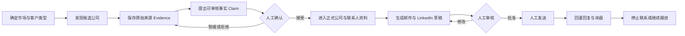

# Inbound AI Acquisition

[](https://github.com/peter-hzy/inbound-ai-acquisition/actions/workflows/ci.yml)
[](https://www.python.org/)
[](LICENSE)

面向中国入境游 B2B 业务的证据驱动型 AI 获客项目。

它用一个 Codex Skill 和一套本地命令，把下面这条工作链串起来：

> 找目标公司 → 判断是否匹配 → 找到负责人 → 核验证据 → 写邮件和 LinkedIn 草稿 → 人工审核发送 → 记录回复与复盘

项目解决的不是“怎样批量群发”，而是“怎样持续找到值得联系的海外客户，并且知道为什么联系、联系谁、说什么、依据是什么”。

---

## 适合谁使用

当前主要服务于中国入境游 B2B 获客：

- 优先市场：澳大利亚、新西兰；
- 同步支持：美国、加拿大；
- 第一阶段客户：海外旅行社、DMC、旅游批发商、旅游运营商；
- 后续可扩展：企业差旅公司、MICE、会展和活动策划公司；
- 第一阶段产品：定制中国线路、地接整包服务；
- 后续产品：商务团、会展接待和活动接待。

如果你的目标是整理一批可靠的潜在合作方、分别准备邮件和 LinkedIn 话术，并把研究依据和后续回复保存下来，这个项目可以直接作为工作底座。

## 它是怎样工作的



三部分各自负责不同的事：

| 参与者 | 负责什么 | 不负责什么 |
|---|---|---|
| Codex Skill | 研究公司、判断匹配度、核验负责人、组织证据、起草话术 | 不擅自发送，不把推测当事实 |
| `inbound-leads` | 保存数据、检查规则、去重、审批留痕、导出 Excel、回灌回复 | 不登录平台，不代替人工做商业承诺 |
| 人工 | 确认产品事实、审核联系人和话术、发送、报价、决定是否继续跟进 | 不需要手工维护零散文件和重复名单 |

## 当前已经具备的功能

### 1. 批次与名单管理

- 每批默认研究 20—25 家公司；
- 可指定国家、客户类型和目标数量；
- 保存批次进度、来源结果和未完成项；
- 用公司域名、LinkedIn URL 和公开邮箱做确定性去重；
- 相似但无法自动确认的记录进入人工重复审查，不会直接合并。

### 2. 公司与负责人研究

- 区分公司主体、联系人、来源记录和研究缺口；
- 负责人可以标记为 `verified`、`supported`、`not_found` 或 `contradicted`；
- LinkedIn 用于发现和核验负责人，也可以作为后续人工联系渠道；
- 没有负责人或公开业务邮箱时允许明确记录“未找到”，不会编造结果；
- 来源受限、没有结果和查询失败会分别记录，避免把失败误写成“该公司不存在”。

### 3. Evidence 与 Claim

项目不会让 AI 直接把判断写成事实，而是分成两层：

- `Evidence`：原网页实际显示的内容、URL、抓取时间和内容哈希；
- `Claim`：根据证据提出的待审核结论，例如“该公司经营亚洲定制游”或“此人负责产品合作”。

只有人工接受的 Claim 才能进入正式运营字段。互相冲突或证据不足的内容会被拦截。

### 4. 邮件与 LinkedIn 草稿

- 邮件和 LinkedIn 分别写，不把同一段文字机械复制到两个渠道；
- 每条信息只保留一个轻量 CTA；
- 草稿必须能够追溯到联系人、Evidence 和已接受的 Claim；
- 联系人未核验、存在阻塞缺口或命中停止规则时，草稿不能进入可审核状态；
- 草稿批准后如果正文被修改，原批准自动失效，必须重新审核。

### 5. 回复、退订与复盘

- 人工发送后使用 `mark-sent` 登记，程序本身不会发送消息；
- 回复可以结构化回灌，并识别询盘、转介绍、拒绝、投诉和退订；
- 退订、投诉或明确停止要求会建立跨渠道 `StopRule`；
- 命中停止规则的待发草稿会停止，避免换渠道继续打扰；
- 重复导入同一回复不会重复创建记录。

### 6. 数据和审计

- SQLite 是唯一正式数据源；
- Excel 和 JSON 是供人工查看、交接和复盘的只读快照；
- 关键写操作进入事件账本；
- 幂等键防止重复操作；
- 支持数据库备份、工作区检查、公开仓库敏感文件检查和发布文件校验；
- 没有付费 API 时，也可以通过公开网页研究和手工导入完成主流程。

## 明确不做什么

V1 有意保持边界清晰：

- 不自动发送邮件；
- 不自动操作或模拟登录 LinkedIn；
- 不使用账号密码、Cookie 或会话令牌；
- 不猜测联系人、职位、邮箱、客户需求、价格、佣金或合作意愿；
- 不把搜索结果摘要直接当成正式证据；
- 不自动报价，不承诺库存、签证、退款、法律或合作条件；
- 不建设完整 CRM、Web 后台、多租户系统或多 Agent 销售团队；
- 不把真实客户数据、回复、密钥和内部价格提交到公开仓库。

这意味着它更像一套“可核验的 AI 获客工作系统”，不是无人值守的群发机器人。

---

## 五分钟安装

### 环境要求

- Git；
- Python 3.11 或更高版本；
- Codex：如果需要使用自然语言驱动的主 Skill；
- Excel 功能使用 `openpyxl`，安装项目的 `[excel]` 可选依赖即可。

真实客户数据应放在仓库外的私有工作区。下面示例使用 `Documents\inbound-leads-data`。

### Windows

```powershell
git clone https://github.com/peter-hzy/inbound-ai-acquisition.git
Set-Location inbound-ai-acquisition

py -3.11 -m venv .venv
.\.venv\Scripts\python.exe -m pip install -e ".[excel]"
.\.venv\Scripts\inbound-leads.exe doctor

$Workspace = "$env:USERPROFILE\Documents\inbound-leads-data"
.\.venv\Scripts\inbound-leads.exe init --workspace $Workspace
```

也可以使用启动脚本一次完成创建虚拟环境、安装和初始化：

```powershell
.\scripts\bootstrap.ps1 -Workspace "$env:USERPROFILE\Documents\inbound-leads-data"
```

以后继续使用时，可以激活虚拟环境：

```powershell
.\.venv\Scripts\Activate.ps1
```

如果 PowerShell 不允许激活脚本，直接使用 `.\.venv\Scripts\inbound-leads.exe` 即可。

### macOS / Linux

```bash
git clone https://github.com/peter-hzy/inbound-ai-acquisition.git
cd inbound-ai-acquisition

python3.11 -m venv .venv
.venv/bin/python -m pip install -e '.[excel]'
.venv/bin/inbound-leads doctor
.venv/bin/inbound-leads init --workspace ~/Documents/inbound-leads-data
```

也可以运行：

```bash
./scripts/bootstrap.sh ~/Documents/inbound-leads-data
```

## 安装 Codex 主 Skill

项目只提供一个需要记忆的用户入口：`inbound-ai-acquisition`。公司研究、负责人核验、外联草稿、回复处理和复盘都是这个主 Skill 的内部工作模式，不需要安装一堆子 Skill。

在项目虚拟环境中运行：

```powershell
inbound-leads skill status
inbound-leads skill install --target codex --replace
inbound-leads skill status
```

最后一次状态应返回：

```json
{
  "status": "succeeded",
  "in_sync": true,
  "changed_files": []
}
```

仓库升级后再次执行 `skill install --replace`，即可同步最新版 Skill。

---

## 开始第一批真实任务

### 第一步：填写产品和语气资料

初始化工作区后会生成：

```text
inbound-leads-data/
├── acquisition.db
├── config.toml
├── product-profile.md
├── voice-profile.md
├── backups/
├── exports/
├── imports/
└── logs/
```

先认真填写两个文件：

- `product-profile.md`：可接待目的地、线路、团组范围、服务能力、语言、提前期、报价边界、资质和不能承诺的事项；
- `voice-profile.md`：邮件和 LinkedIn 的语气、允许表达、禁用表达、真实证明和去除 AI 味的要求。

填写完成后检查：

```powershell
inbound-leads context validate --workspace $Workspace
```

只有返回 `"status": "succeeded"` 才表示基础资料检查通过；如果返回 `needs_review`，请根据 `profile_gaps` 补齐必填内容。产品资料不完整时不要急着批量写信，否则 AI 只能生成看起来完整、实际上无法兑现的话术。

### 第二步：创建研究批次

```powershell
inbound-leads run create `
  --workspace $Workspace `
  --market AU,NZ `
  --segments travel_agency,dmc,tour_operator `
  --target 20 `
  --idempotency-key first-au-nz-batch
```

命令会返回一个 `run_id`。后面的导入、查看进度和导出都使用这个批次编号。

### 第三步：让 Codex 执行研究

可以直接对 Codex 说：

```text
使用 inbound-ai-acquisition，为我建立第一批澳大利亚和新西兰潜在客户名单。
优先找海外旅行社、DMC 和旅游批发商，共 20 家。
逐家公司核验业务匹配度、负责人、LinkedIn 和公开业务邮箱，保存原始来源和日期。
分别生成自然的英文邮件与 LinkedIn 草稿，不猜信息，不要发送。
完成后导出 Excel 给我审核。
```

也可以先给 Codex 一批已有公司：

```text
使用 inbound-ai-acquisition，研究 companies.json 中的公司。
核验公司主体、入境游合作可能性和负责人身份；证据不足就明确标记未知。
不要为了填满名单而降低标准，不要发送任何消息。
```

### 第四步：导入已有候选公司

如果已经有自己的名单，可以准备 UTF-8 JSON：

```json
[
  {
    "name": "Example Travel",
    "country": "AU",
    "segment": "travel_agency",
    "website": "https://example.test",
    "fit_reason": "公开经营亚洲定制线路"
  }
]
```

然后导入：

```powershell
inbound-leads import companies `
  --workspace $Workspace `
  --run <run_id> `
  --file companies.json
```

导入不是必需步骤；使用 Skill 时，Codex 也可以按照数据合同生成并导入研究结果。

### 第五步：查看进度和导出审核表

```powershell
inbound-leads run status --workspace $Workspace --run <run_id>

inbound-leads export workbook `
  --workspace $Workspace `
  --run <run_id> `
  --output "$Workspace\exports\first-batch.xlsx"
```

Excel 包含 12 张工作表：

| 工作表 | 用途 |
|---|---|
| `RunSummary` | 批次目标与当前状态 |
| `Companies` | 候选公司及正式字段 |
| `Contacts` | 负责人、职位和联系方式 |
| `Evidence` | 来源、观察内容和抓取时间 |
| `Claims` | 待确认或已接受的事实 |
| `ResearchGaps` | 未知项及是否阻止外联 |
| `Drafts` | 邮件和 LinkedIn 草稿 |
| `Approvals` | 人工批准记录与正文哈希 |
| `Replies` | 回复、询盘和拒绝记录 |
| `StopRules` | 退订、投诉和停止联系规则 |
| `DuplicateReview` | 需要人工判断的疑似重复记录 |
| `SourcePerformance` | 各来源查询成功、无结果、受限或失败情况 |

Excel 是审核快照，不是数据库。不要直接修改 Excel 后把它当成正式结果；需要回写时使用受控导入和变更预览。

### 第六步：人工审核与发送

正式触达前至少确认：

- 公司确实属于目标客户类型；
- 负责人身份和职责有公开证据；
- 邮箱是公开、可验证的业务联系方式；
- 草稿没有虚构资质、案例、价格或合作意愿；
- 开场理由确实来自这家公司，而不是通用套话；
- 邮件和 LinkedIn 各自符合渠道习惯；
- 每条消息只有一个清晰、低压力的下一步；
- 没有命中退订或停止联系规则。

系统只负责记录批准。消息仍由人工在邮箱或 LinkedIn 中发送。

### 第七步：回灌回复

把回复整理成结构化 JSON 后运行：

```powershell
inbound-leads reply ingest `
  --workspace $Workspace `
  --file reply.json `
  --idempotency-key reply-2026-001
```

回复涉及报价、会议、RFP、投诉、退订或具体服务承诺时，必须交给人工处理。项目会保存结果和停止规则，但不会自行作出商业决定。

---

## 关键数据概念

| 名称 | 小白理解 | 为什么需要 |
|---|---|---|
| `Run` | 一批获客任务 | 防止不同市场和名单混在一起 |
| `SourceRun` | 一次具体查询 | 区分成功、没结果、受限和失败 |
| `Evidence` | 网页实际看到的证据 | 防止 AI 把印象写成事实 |
| `Claim` | 根据证据提出的结论 | 让人工决定接受、暂缓或拒绝 |
| `ResearchGap` | 还没查清楚的地方 | 知道能否继续写信，避免硬凑答案 |
| `Draft` | 待审核消息 | 邮件和 LinkedIn 分开管理 |
| `Approval` | 人工批准记录 | 正文变化后自动要求重新审核 |
| `Reply` | 对方真实反馈 | 用于识别询盘、拒绝和下一步 |
| `StopRule` | 不应继续联系的规则 | 避免退订后换渠道继续打扰 |
| `Event` | 操作流水账 | 以后可以追溯谁在何时做了什么 |

完整定义见 [数据模型](docs/data-model.md) 和 [架构说明](ARCHITECTURE.md)。

## 常用命令

```text
doctor                                检查运行环境
init --workspace                      初始化私有工作区
migrate --workspace                   升级数据库结构
backup --workspace                    备份数据库
context validate --workspace          检查产品和语气资料
run create|status|close               创建、查看和关闭批次
import companies|contacts|evidence    导入研究数据
source list|status|record              查看和保存来源查询
company list|show                      查看公司
contact list|show                      查看联系人
claim propose|list|accept|hold|reject  管理待审核事实
dedupe scan|review                     扫描并人工处理重复记录
draft create|check|approve             创建、检查和批准草稿
draft mark-sent|stop                   登记人工已发送或停止草稿
reply ingest                           回灌回复
stop add|list|release                  管理停止联系规则
export workbook|json                   导出审核结果
audit workspace|public-repo|release    执行数据和发布检查
skill install|status                   安装或检查 Codex Skill
```

每个命令的完整参数见 [CLI 文档](docs/cli.md)。也可以运行：

```powershell
inbound-leads --help
inbound-leads <一级命令> --help
```

## 数据安全

仓库只保存代码、规则、模板和虚构示例。真实数据目录必须放在仓库外，例如：

```text
GitHub 仓库： C:\Projects\inbound-ai-acquisition
私有工作区： C:\Users\you\Documents\inbound-leads-data
```

不要提交以下内容：

- `acquisition.db`；
- 真实公司与联系人名单；
- 客户回复和内部备注；
- API Key、邮箱密码、Cookie 和会话令牌；
- 内部价格、佣金、合同和未公开案例。

发布前可以运行：

```powershell
inbound-leads audit workspace --workspace $Workspace
inbound-leads audit public-repo
inbound-leads audit release
```

更多说明见 [隐私与数据边界](docs/privacy.md) 和 [安全政策](SECURITY.md)。

## 项目结构

```text
inbound-ai-acquisition/
├── SKILL.md                    Codex 主入口和工作路由
├── src/inbound_ai_acquisition/ Python 包与 inbound-leads CLI
│   ├── adapters/               来源适配器合同
│   ├── application/            完整业务用例与事务
│   ├── audit/                  数据、仓库和发布检查
│   ├── domain/                 状态、政策和安全门禁
│   ├── exporters/              Excel 与 JSON 导出
│   └── storage/                SQLite、迁移和仓储
├── migrations/                 数据库迁移标记
├── references/                 研究、身份、话术与安全规则
├── templates/                  产品、语气、来源和回复模板
├── docs/                       快速开始、CLI、UAT 与故障排查
├── scripts/                    启动、Skill 校验和发布检查
├── tests/                      单元、集成、安全和端到端测试
├── examples/                   纯虚构示例
├── ARCHITECTURE.md             架构与模块职责
└── skills.lock.json            发布文件完整性清单
```

## 开发与验证

安装开发依赖：

```powershell
py -3.11 -m pip install -e ".[dev]"
```

运行完整检查：

```powershell
ruff check src tests scripts
py -3.11 -m unittest discover -s tests -p "test_*.py" -v
python -X utf8 scripts/validate_skill.py .
python -X utf8 scripts/three_pass_check.py
inbound-leads audit public-repo
inbound-leads audit build-lock
inbound-leads audit release
```

GitHub Actions 会在以下四种组合中运行同一套检查：

- Windows + Python 3.11；
- Windows + Python 3.12；
- Ubuntu + Python 3.11；
- Ubuntu + Python 3.12。

## 当前验证边界

当前工程验证已经完成：

- 全新目录克隆和安装通过；
- 15 个自动化测试通过；
- Windows/Linux 跨平台 CI 通过；
- Skill 结构、业务闭环和安全边界三遍检查通过；
- 公开仓库敏感文件检查与发布锁检查通过。

这些结果证明程序可以按照既定合同运行，但不代表已经证明真实获客转化率。

业务正式验收仍需完成：

1. 选择 5 家真实公司做只读前向测试；
2. 使用 20—25 家真实公司完成一批 UAT；
3. 人工记录负责人准确率、改稿原因、回复与询盘；
4. 验证退订、投诉、重复回复和审批失效；
5. 根据真实结果调整来源、判断规则和话术。

在这些步骤完成前，应把项目视为“工程可用、业务待验证”，不能宣称已经证明转化效果。详细标准见 [正式 UAT](docs/uat.md)。

## 常见问题

### 这是 CRM 吗？

不是。它管理的是获客前期最重要的公司、负责人、证据、草稿和回复闭环。后续客户量、团队成员和成交阶段明显增加时，再考虑接入 CRM。

### 会自动发邮件或 LinkedIn 消息吗？

不会。系统只研究、起草、检查和记录。发送、报价和承诺必须由人工完成。

### 没有付费 API 能不能用？

可以。公开网页、公司官网、公开 LinkedIn 页面和手工导入足以运行主流程。付费数据源以后可以通过 `adapters/` 接入，但不是启动条件。

### 找不到负责人或邮箱怎么办？

如实保存 `not_found` 或研究缺口。不要猜邮箱，也不要因为名单不够 20 家就降低证据标准。

### 为什么 Excel 不能直接当数据库？

Excel 适合人工审阅，但容易被误改、覆盖和复制。SQLite 保存正式状态、审批关系、幂等记录和事件历史，Excel 只负责让人看得清楚。

### 为什么第一封邮件后默认不自动跟进？

当前重点是先训练名单质量和话术，而不是增加发送量。第一批真实结果出来后，再根据回复周期和业务特点决定是否增加人工审核的跟进节奏。

## 文档导航

- [完整改进方案](AI获客项目完整改进方案.md)
- [架构说明](ARCHITECTURE.md)
- [快速开始](docs/quickstart.md)
- [CLI 命令](docs/cli.md)
- [数据模型](docs/data-model.md)
- [来源适配器](docs/source-adapters.md)
- [隐私与数据边界](docs/privacy.md)
- [故障排查](docs/troubleshooting.md)
- [正式 UAT](docs/uat.md)
- [开源项目借鉴记录](references/open-source-adaptation.md)
- [贡献指南](CONTRIBUTING.md)

## 开源与许可证

本项目使用 [MIT License](LICENSE)。

项目只借鉴适合本业务的通用设计思想，不复制许可证不清晰的源码，也不采用随机生成 Lead、猜邮箱、关闭 TLS、绕过平台限制或静默吞错等做法。具体取舍见 [开源项目借鉴记录](references/open-source-adaptation.md)。
